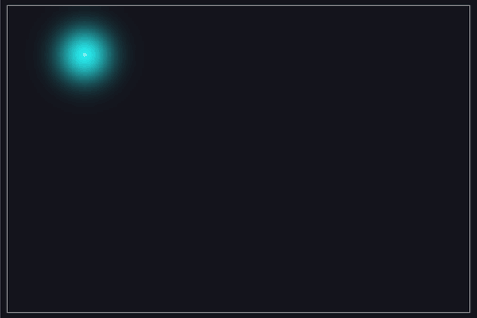
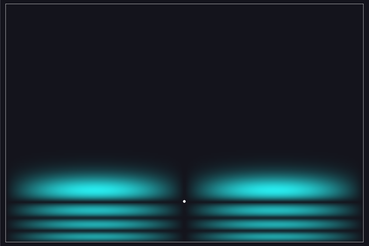

# Quantum Bouncing Ball

The same problem solved twice: a ball in a rectangular box with hard walls
under gravity, once as a point mass and once as a wave packet obeying the
Schrödinger equation. A third mode shows the stationary states of the quantum
bouncer, the Airy-function states that were measured with ultracold neutrons
in 2002.



*Quantum mode: the packet follows the classical trajectory at first, then
disperses and the reflected and incident waves interfere. Full-length video:
[media/quantum_ball.mp4](media/quantum_ball.mp4).*

| ψ₁,₁ — the ground state sits on the floor | ψ₂,₄ — four Airy lobes, two across |
|---|---|
|  |  |

## Build and run

Needs SDL2, FFTW3 (double precision) and a C11 compiler.

```
sudo apt install libsdl2-dev libfftw3-dev   # Debian/Ubuntu
sudo dnf install SDL2-devel fftw-devel      # Fedora
brew install sdl2 fftw                      # macOS

make            # ./quantum_ball
make test       # numerical self-test, no window needed
make install    # ~/.local/bin, man page, docs; PREFIX=/usr/local for system-wide
make uninstall
```

```
quantum_ball                   # interactive, starts in classical mode
quantum_ball --mode quantum
quantum_ball --state 2,4       # eigenstate ψ₂,₄
man quantum_ball
```

**Controls.** Sliders: launch angle, speed, gravity, box width and height.
Keys: `C` classical, `Q` quantum, `E` eigenstates, `R` reset, `Space`
pause, `Esc` quit; in eigenstate mode the arrow keys change the quantum
numbers (←→ for *n*, ↑↓ for *m*). The white dot is ⟨x⟩,⟨y⟩.

## The model

Coordinates are screen-like: *y* increases downward and gravity points
downward, so the potential is

$$V(x,y) = -mgy$$

and the *floor* of the bouncer is the bottom wall *y = L_y*. The sign
matters: flip it and the packet floats to the ceiling.

**Classical mode** integrates $\dot v_y = g$ with elastic reflections.

**Quantum mode** solves

$$i\hbar\,\frac{\partial\psi}{\partial t} = \left[-\frac{\hbar^2}{2m}\Delta - mgy\right]\psi,
\qquad \psi = 0 \text{ on the walls},$$

with $\hbar = m = 1$ and parameters chosen for a visually useful regime, not
SI units.

## Numerical method

**Strang split-step.** One time step is

$$\psi^{n+1} = e^{-iV\Delta t/2\hbar}\; e^{-iT\Delta t/\hbar}\; e^{-iV\Delta t/2\hbar}\;\psi^n .$$

The potential factor is a pointwise phase. The kinetic factor is diagonal in
the sine basis

$$\sin\frac{n\pi x}{L_x}\,\sin\frac{m\pi y}{L_y},\qquad
T_{nm} = \frac{\hbar^2}{2m}\left[\left(\frac{n\pi}{L_x}\right)^2 + \left(\frac{m\pi}{L_y}\right)^2\right],$$

which satisfies the hard-wall condition automatically. The transform to and
from that basis is a 2-D DST-I, done with one FFTW `r2r` plan (`RODFT00` in
both directions); DST-I is its own inverse up to a factor $2(N+1)$ per
dimension. Each step is therefore exactly unitary, and the energy is
conserved to $O(\Delta t^2)$. The panel shows both the norm and
$\langle E\rangle = \langle T\rangle - mg\langle y\rangle$, with $\langle T\rangle$
read off the spectral coefficients (Parseval). In double precision the
self-test reports a norm drift of ~1e-13 and a relative energy drift of
~1e-7 over 3000 steps. There is no renormalisation: a drifting norm would be
a bug, so it is displayed rather than hidden.

The grid has 20 points per unit length. The default packet carries momentum
28, a wavelength of 0.22, so about 4.5 points per wavelength. Push the speed
much higher and the display tells you the grid is too coarse.

**Eigenstates.** With $V$ depending on *y* only, the states separate:
$\psi_{n,m} = \sin(n\pi x/L_x)\,\varphi_m(y)$, where $\varphi_m$ solves

$$-\tfrac12\varphi'' - gy\,\varphi = E_y\varphi,\qquad \varphi(0)=\varphi(L_y)=0 .$$

It is found by Numerov shooting from the ceiling: the node count brackets
$E_m$, then bisection on the sign of $\varphi(L_y)$ pins it to 1e-13. When the
ceiling is far above the turning point these are the Airy states of a ball
bouncing on a floor,

$$E_m = -gL_y + |a_m|\left(\frac{g^2}{2}\right)^{1/3},$$

with $a_m$ the zeros of $\mathrm{Ai}$. The panel shows both numbers; for the
default parameters they agree to six figures. This is the system in which
quantum states of a bouncing particle were first observed, with ultracold
neutrons at the ILL (Nesvizhevsky et al., *Nature* 415, 297 (2002)). Loading
an eigenstate into the time-evolution and watching ⟨y⟩ stay put is a second
check of the propagator; the self-test does exactly that.

## Files

| File | |
|---|---|
| `quantum_ball.c` | the program: classical, quantum and eigenstate modes, self-test, frame recorder |
| `quantum_ball.1` | man page |
| `Makefile` | build, test, install, GIF regeneration |
| `legacy/quantum_ball_rk4.c` | the first version: finite differences with RK4 time stepping, SDL2 only. Not unitary and conditionally stable; kept for comparison (`make legacy`) |
| `legacy/spectral_ball_octave.m` | the second version: a pure Galerkin sine-basis solver in Octave, propagating each x-mode with a precomputed matrix exponential |
| `media/` | GIF, MP4 and stills rendered from the program (`make gif`); `octave_spectral_ball.mp4` is from the Octave version |

The program can render without a display, which is how the media are made:

```
SDL_VIDEODRIVER=dummy ./quantum_ball --mode quantum --frames 300 --record frames/
```

## Licence

GPL-3.0-or-later.
